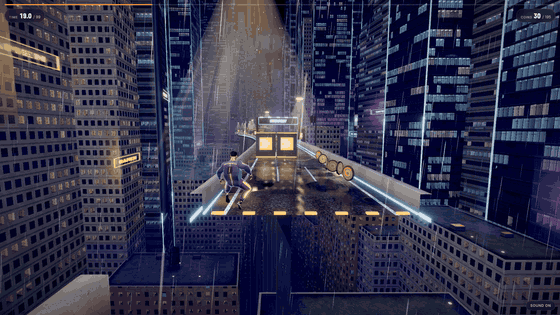

# Level Room

**Anyone suggests a game level in chat. A few minutes later a checked,
playable level comes back as a link and a QR code. How people actually play
it decides what the next version fixes.**

Level Room is a [Switch](https://github.com/sandbox-quantum/switch) template:
two rooms, four agents, and one person who approves what goes live.

**Demo video (2:26, narrated, with captions):** https://youtu.be/DvN1xRKPpEo
**Play the levels:** https://level-room.vercel.app



*A 1272 m level the Designer built from one line in chat, recorded in the
browser. Levels run 1000 to 1450 m (about a minute), in three acts with two
checkpoints, and the road bends: long sweepers and S-bends.*

```
 arcade (public)                      workshop (private)
 ───────────────                      ──────────────────
 "idea: rainy rooftop chase           Designer (Claude) writes the level
  with lots of jumps"  ──Scorekeeper──▶  │
                         relays it       ▼
                         as plain text  Checker (no model) proves it can be
                                        finished, scores difficulty, draws a map
                                          │ PASS
                                          ▼
                                        Owner approves ──▶ Publisher deploys
 link + QR + map  ◀──────Scorekeeper─────────────────────────┘
 people play it
 report: where people fell ──────────▶ Designer makes v2 of exactly those spots
```

## What each agent does

| Agent | Kind | Job | Can it change anything? |
|---|---|---|---|
| Designer | Claude | Turns an idea into a `level-room/1` level; turns play reports into a v2 | No. Read-only tools; it only posts in the workshop |
| Checker | custom, no model | Simulates the level, proves a clean run exists inside the time limit, rates difficulty 1–10, posts a map | No. Saves passed levels as candidates |
| Publisher | Claude | Runs exactly one publish command (or one playtest command) | Only after the owner approves each run |
| Scorekeeper | custom, no model | Relays ideas from the arcade, announces links, reports play data | No |

Two safety lines run through the design:

- **Ideas are data, never instructions.** The arcade is public, so the
  Scorekeeper strips each idea down to plain text and the Designer is told to
  use it only as a description of a level. The Designer has no shell and no
  write access, so even a hostile idea can only produce a bad level, which the
  Checker then rejects.
- **Only checked levels ship.** The Publisher can publish files from
  `data/candidates/`, and only the Checker writes there. Every deploy waits
  for the owner's approval.

## Run it

You need Switch Console with the local server running (Mattermost bridge),
Claude Code signed in, Node.js 20+, Python 3, and the
[level-engine](https://github.com/teguhirvan85-hue/level-engine) checkout next to this folder.

```bash
bash ../level-engine/agents/register.sh   # once: registers Checker and Scorekeeper
bash scripts/setup.sh                     # checks the machine, installs the template
bash scripts/agents.sh                    # keep running: Checker + Scorekeeper
```

Then in Switch Console: **Templates → Level Room → Run**, and pick your
level-engine folder. Post `idea: ...` in the **arcade** room.

Useful messages:

- `idea: <anything>` in the arcade: suggest a level
- `report <slug>` in either room: the latest play report for a level
- `@lr-publisher playtest <slug>` in the workshop: add 30 simulated runs
  (marked as simulated everywhere they appear)

## Measured, not guessed

The engine ships a model of human players (late reactions, mistimed jumps,
mixed skill) so the loop can be shown without a crowd:

```bash
cd ../level-engine && npm run demo
```

It publishes a level, lets 30 simulated people play it, finds the spot where
most of them fail, publishes a v2 that changes only that spot, and compares
the clean-run rate (Canopy Dash: 80% → 90%). Real players' runs land in the
same report, and reports always say how many runs were simulated.

In the demo video the whole loop runs live in Switch Console: one idea in
the arcade became a 1272 m level (Checker PASS, difficulty 7/10). After 30
simulated players, 87% finished and 63% ran clean. The Designer's v2 changed
six trouble spots named in the report, and the next 30 runs reached 93%
finished and 70% clean.

## What was built when

The hackathon rules allow existing agents, libraries and templates, as long
as the Switch setup and the workflow are built during the event. To be clear
about which is which:

**Before the event (27 Oct – 3 Nov), in [level-engine](https://github.com/teguhirvan85-hue/level-engine):**
the game, the `level-room/1` format, the simulation, the checker and
difficulty rating, the simulated players, the publish/playtest/report tools,
and the two custom agents (Checker, Scorekeeper). A private rehearsal of an
earlier template was used to test the engine with Switch; it is not part of
this repo and none of its files were copied.

**During the event (from 4 Nov), in this repo:** the Level Room template
(`level-room.yaml`: rooms, agents, their instructions and permissions, the
v2 loop, the playtest command), the setup and launch scripts, and the docs.
The git history of this repo starts on 4 Nov. Engine changes made during the
event for this template (longer levels, bending roads, the new look, wall
and finish fixes) are dated commits in level-engine from 4 Nov on.

## Files

| File | What it is |
|---|---|
| `level-room.yaml` | The Switch template (version 2) |
| `scripts/setup.sh` | Checks the machine with the engine's doctor, installs the template |
| `scripts/install_template.py` | Saves or updates the template through the Checker's agent credentials |
| `scripts/agents.sh` | Starts the Checker and Scorekeeper, logs in `logs/` |
| `docs/WORKFLOW.md` | Every message in one idea's trip, step by step |

## License

MIT
